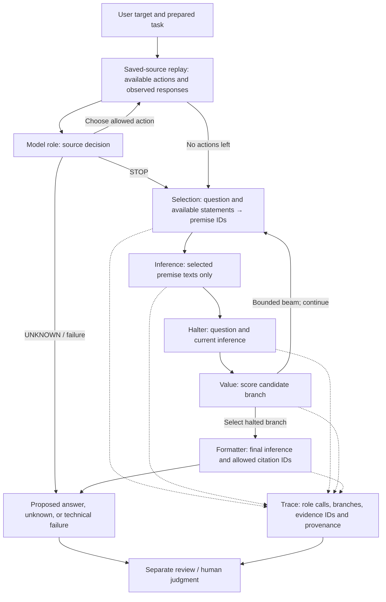

# Faithful Engine architecture / Архитектура Faithful Engine

## English

This diagram describes the local `faithful_v3` research controller and its saved-source replay, not a deployed FitCheck product. Each named model role is a separate callback request; an offline test can substitute scripted responses. Python validates the shape of inputs and outputs, routes calls, records provenance and bounds the work. It does not replace the model roles or establish semantic truth.

The acquisition loop reads previously saved source responses; it is not live market or news retrieval. Source hashes identify saved inputs, not independent verification. Inference is given only selected premises plus its fixed instruction, but the model retains its learned knowledge. The v3 formatter receives the final inference and allowed citation IDs; an earlier prototype has a different formatter context.

The role outputs and trace are **unreviewed**, and a trace is not proof of entailment, causal faithfulness, factual correctness or alignment. An independent review and the human's own judgment remain separate. When a run stops for budget, invalid output or uncertainty, those outcomes must remain distinguishable. The offline demo uses scripted callbacks and is not evidence of model performance.

## Русский

Диаграмма показывает локальный исследовательский контроллер `faithful_v3` и воспроизведение ранее сохранённых источников; это не развёрнутый продукт FitCheck. Каждая модельная роль — отдельный вызов через callback; в офлайн-тестах ответы могут быть заранее заданными. Python проверяет структуру, направляет вызовы, сохраняет происхождение и ограничивает выполнение. Он не заменяет модельные роли и не устанавливает истинность выводов.

Внешний цикл читает сохранённые ответы источников, а не получает новые данные рынков или новости. Хеш идентифицирует сохранённые входы, но не подтверждает их независимую достоверность. Inference получает только выбранные посылки и фиксированную инструкцию, хотя сохраняет знания, усвоенные моделью. Formatter версии v3 получает финальный вывод и допустимые идентификаторы источников; контекст formatter в более раннем прототипе отличается.

Результаты ролей и трасса **не проверены содержательно**. Трасса не доказывает логическую корректность, причинную верность рассуждения, истинность фактов или соответствие ценностям человека. Независимая оценка и собственное суждение человека остаются отдельными. Исчерпание бюджета, некорректный ответ и неопределённость необходимо различать. Офлайн-демо использует заранее заданные ответы и не является результатом испытания модели.
