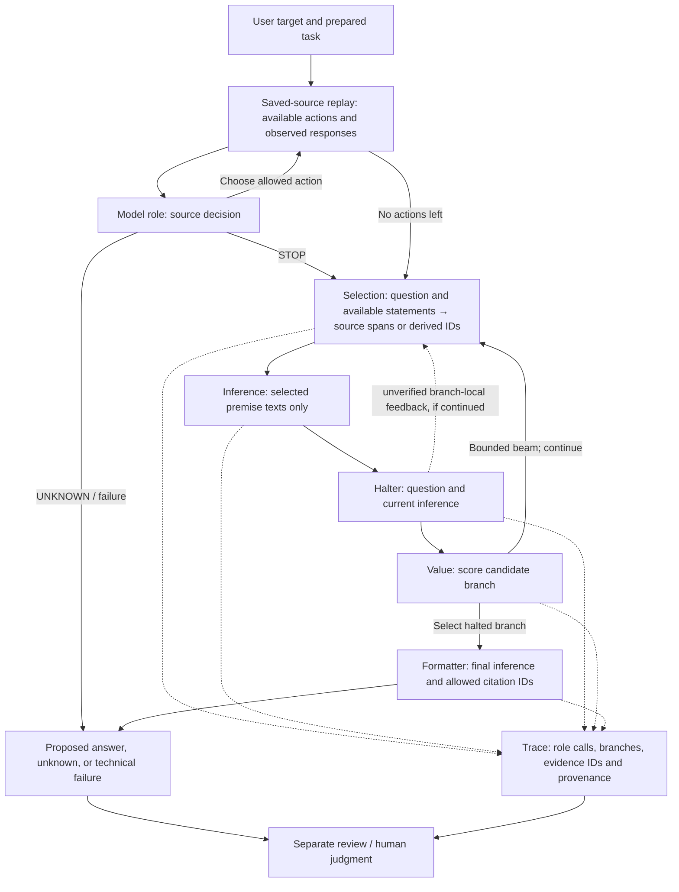

# Faithful Engine architecture / Архитектура Faithful Engine

## English

This diagram describes the local `faithful_v3` research controller and its saved-source replay, not a deployed FitCheck product. Each named model role is a separate callback request; an offline test can substitute scripted responses. Python validates the shape of inputs and outputs, routes calls, records provenance and bounds the work. It does not replace the model roles or establish semantic truth.

The acquisition loop reads previously saved source responses; it is not live market or news retrieval. Source hashes identify saved inputs, not independent verification. Inference is given only selected premises plus its fixed instruction, but the model retains its learned knowledge. The v3 formatter receives the final inference and allowed citation IDs; an earlier prototype has a different formatter context.

Halter feedback is passed only to the next Selection on the same continuing branch as an unverified observation; it is not a source fact or an Inference input. For structured saved responses, Selection proposes exact passage spans; the controller checks their bounds and payload-hash consistency, then supplies only the selected substring to Inference. For unstructured responses it can also select exact Unicode spans in the saved evidence-text view; the view is raw text for nonblank string payloads and serialized JSON for objects, lists and blank strings. Whole-response selection remains an explicitly labelled fallback. Text-view offsets are not original-document offsets. Captured passage coordinates are source-reported; without the complete original document they cannot be independently verified. A matching substring does not establish semantic support.

When no final answer is produced, a structured explanation separates the recorded stop condition from an optional, unverified model assessment of the recorded inference and source references. The default v3/stop renderer uses per-view aliases for questions, sources, passages and branches, plus bounded call ordinals and offsets; it omits original IDs, hashes, model text, source text and user input. The explicit private view includes an alias key with sanitized display identifiers and SHA-256 fingerprints of the original IDs; these fingerprints can be linkable and the view may contain sensitive content. This is a limited projection, not a general guarantee that rendered material is safe to publish; bounded fields may be omitted or truncated, and the v1 renderer and opt-in views may include sensitive content.

An absent saved capture yields a scoped preflight `unknown` before any model callback; it is not a claim that the external source has no information. A callback timeout or connection failure is recorded as an interrupted callback with the effect not established; callback entry alone does not prove dispatch. Other callback failures retain a technical status and explicitly record that the effect is not established. The optional effect journal owns its own durable attempt states and only retries an explicitly authorized 429. The bounded view distinguishes call limits from depth limits.

The role outputs and trace are **unreviewed**, and a trace is not proof of entailment, causal faithfulness, factual correctness or alignment. An independent review and the human's own judgment remain separate. When a run stops for budget, invalid output or uncertainty, those outcomes must remain distinguishable. The offline demo uses scripted callbacks and is not evidence of model performance.

## Русский

Диаграмма показывает локальный исследовательский контроллер `faithful_v3` и воспроизведение ранее сохранённых источников; это не развёрнутый продукт FitCheck. Каждая модельная роль — отдельный вызов через callback; в офлайн-тестах ответы могут быть заранее заданными. Python проверяет структуру, направляет вызовы, сохраняет происхождение и ограничивает выполнение. Он не заменяет модельные роли и не устанавливает истинность выводов.

Внешний цикл читает сохранённые ответы источников, а не получает новые данные рынков или новости. Хеш идентифицирует сохранённые входы, но не подтверждает их независимую достоверность. Inference получает только выбранные посылки и фиксированную инструкцию, хотя сохраняет знания, усвоенные моделью. Formatter версии v3 получает финальный вывод и допустимые идентификаторы источников; контекст formatter в более раннем прототипе отличается.

Замечание Halter передаётся только следующему Selection в той же продолжающейся ветви как непроверенное наблюдение; оно не становится фактом источника или входом Inference. Для структурированного сохранённого ответа Selection предлагает точные границы фрагмента; контроллер проверяет их и хеш сохранённых данных, после чего передаёт Inference только выбранный текст. В неструктурированном ответе также можно выбрать точный диапазон: в сохранённом тексте для непустых строк или в сериализованном JSON для объектов, списков и пустых строк. Явно помеченный выбор всего ответа остаётся доступным. Координаты текстового представления не являются координатами исходного документа; координаты сохранённого отрывка сообщены источником и без полного оригинала не подтверждаются независимо. Совпадение текста не доказывает содержательную поддержку вывода.

Если итоговый ответ не получен, структурированное объяснение отделяет причину остановки от необязательной непроверенной модельной оценки записанного вывода и ссылок на источники. Отображение v3 и остановок по умолчанию использует локальные обозначения вопросов, источников, отрывков и ветвей с ограниченными номерами вызовов и координатами; исходные идентификаторы, хеши и тексты скрыты. Подробный приватный режим включает ключ с очищенными идентификаторами и SHA-256 исходных ID; хеши могут связывать записи, а сам режим — содержать чувствительные данные. Это ограниченная проекция, а не общая гарантия безопасности публикации: часть полей может быть пропущена или усечена, а отображение v1 и приватный режим могут содержать чувствительные данные.

Отсутствие сохранённого ответа даёт ограниченный `unknown` до вызова модели; это не утверждение об отсутствии информации у внешнего источника. Таймаут или разрыв соединения внутри callback записывается как прерванный callback с неустановленным эффектом; вход в callback не доказывает отправку запроса. Другие ошибки callback сохраняют технический статус и отдельную пометку, что эффект не установлен. Необязательный журнал эффектов ведёт свои устойчивые состояния попыток и повторяет только явно разрешённый 429. Безопасный вид различает лимит вызовов и лимит глубины.

Результаты ролей и трасса **не проверены содержательно**. Трасса не доказывает логическую корректность, причинную верность рассуждения, истинность фактов или соответствие ценностям человека. Независимая оценка и собственное суждение человека остаются отдельными. Исчерпание бюджета, некорректный ответ и неопределённость необходимо различать. Офлайн-демо использует заранее заданные ответы и не является результатом испытания модели.
